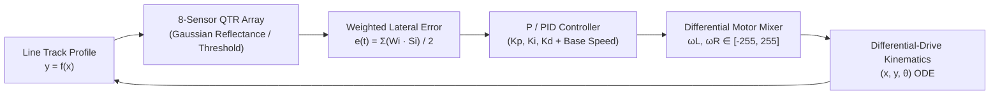

# Line Follower Robot — Simulink Control, System ID & Arduino Firmware

A complete embedded-control and simulation suite for an **8-channel QTR-8A Line Follower Robot**, bridging **Arduino hardware firmware**, **programmatic MATLAB/Simulink closed-loop models**, and **transfer-function / frequency-response system identification**.

---

## System Architecture



---

## Repository Structure

```text
line-follower-simulink/
├── firmware/
│   ├── Main.ino                        # Arduino line-following firmware with serial PID/speed tuning
│   ├── configuration.h                 # Pin mapping (QTR A0–A7, H-bridge PWM 5/6/9/10) & gains
│   └── Sensor/Sensor.ino               # Standalone QTR-8A calibration & serial monitor utility
├── simulink/
│   ├── LineFollowerPID.slx             # Closed-loop discrete Simulink model
│   ├── LineFollower_8Sensors_P.slx     # 8-sensor proportional control Simulink model
│   ├── LineFollower_P_Controller.slx   # P-only controller Simulink model
│   ├── build_line_follower_model.m     # Programmatic Simulink builder (P-only closed-loop)
│   ├── build_line_follower_P_model.m   # Programmatic 8-sensor P-controller builder
│   ├── build_gain_driven_model.m       # Gain-driven Simulink block architecture builder
│   ├── line_follower_simulation.m      # Standalone MATLAB closed-loop kinematics simulation
│   ├── reflectance_position.m          # Continuous sensor reflectance & position model
│   ├── transfer_function_analysis.m    # Closed-loop transfer function & stability analysis
│   └── plot_results.m                  # Trajectory, error & motor command plotting
└── control_analysis/
    ├── Closed_Loop.slx                 # Closed-loop response verification model
    ├── Transfer_Function.slx           # Identified plant transfer-function Simulink model
    ├── Transfer_Fn.m                   # Empirical plant ID from simulation run data
    ├── Frequency_Response.m            # Bode & frequency-domain stability margin script
    ├── Dataset.mat                     # Logged step/tracking datasets
    ├── Transfer Function.pdf           # Derived transfer function report
    └── figures/                        # Closed-loop & critical/unity gain time-response plots
```

---

## Hardware & Control Specifications (`firmware/configuration.h`)

- **Sensor Array**: 8× QTR Analog Reflectance Sensors (`A0`–`A7`), weights `[-3, -2, -1, 0, 0, 1, 2, 3]` with lost-line direction memory.
- **Motor Driver**: Dual H-bridge PWM pins (`IN1=5`, `IN2=6`, `IN3=9`, `IN4=10`), clamped to `[-255, 255]`.
- **Serial Telemetry & Tuning** (`115200` baud): Live commands `START`, `STOP`, `KP:<val>`, `SPEED:<val>`, and `TUNE`.

---

## Running the Simulink & MATLAB Scripts

1. Open MATLAB/Simulink (`R2024b` or compatible) and navigate to `simulink/`:
   ```matlab
   cd simulink
   build_line_follower_model   % Builds & opens LineFollowerPID.slx
   ```
2. Click **Run** in Simulink, then visualize logged signals:
   ```matlab
   plot_results
   ```
3. Run standalone MATLAB simulation or control analysis:
   ```matlab
   line_follower_simulation
   transfer_function_analysis
   ```
4. For frequency-response and transfer-function validation, open `control_analysis/` and run `Transfer_Fn` or `Frequency_Response`.

---

## License
MIT License — see [LICENSE](LICENSE).
